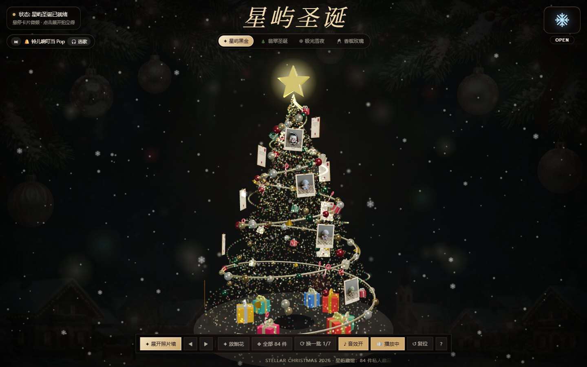
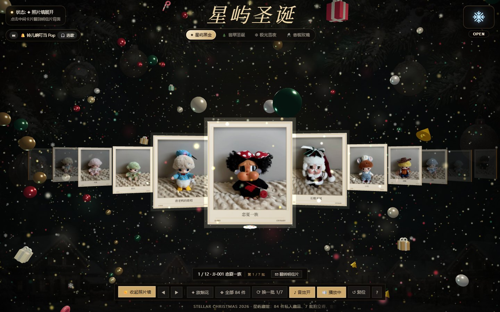
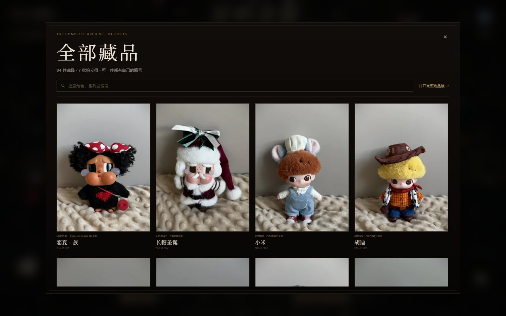

# 星屿藏馆 · 圣诞奇境

> 把 84 件私人泡泡玛特藏品挂上一棵金色星尘圣诞树。
> 这是 **星屿藏馆** 的独立圣诞项目，不替换原来的 `starlit-archive` 藏品馆。



## 预览

| 圣诞树 | 照片墙 |
| --- | --- |
|  |  |
| **全部 84 件** | **手机界面** |
|  |  |

## 这是什么

- **一棵会发光的 3D 粒子圣诞树**：4500 颗金/香槟/酒红粒子、金色丝带、雪花、礼盒与烟花。
- **7 批 × 12 件藏品拍立得**：84 件照片按批次挂上树，点「换一批」依次浏览。
- **展开照片墙**：点开后将 12 张拍立得铺成弧形，可左右切换、拖拽旋转。
- **翻转明信片**：点中间卡片翻到背面，读这件藏品的小传和晶晶的落款。
- **全部 84 件藏品册**：搜索角色、系列或编号，点任意一件直接挂上树；也可以跳转到原来的完整藏品馆。
- **四款主题**：星屿黑金、翡翠圣诞、极光雪夜、香槟玫瑰。
- **零构建**：Three.js 已内置，照片与数据静态托管，适合 GitHub Pages。

## 本地预览

```bash
node server.mjs
# http://127.0.0.1:4186
```

也可以用任意静态服务器：

```bash
python -m http.server 4186
```

## 目录

```text
.
├── index.html                     # 页面与所有控件
├── styles/
│   ├── main.css                   # 原项目的主题/布局基础
│   └── stellar-christmas.css      # 星屿黑金视觉、藏品册、移动端
├── src/
│   ├── config.js                  # 主题、7 批藏品、音乐与手势配置
│   ├── collection-data.js         # 84 件藏品数据（由脚本生成）
│   ├── main.js                    # 批次、全部藏品、交互与动画编排
│   ├── scene.js                   # 3D 粒子树、雪花、礼盒、烟花
│   ├── polaroids.js               # 拍立得正反面与翻转
│   ├── audio.js                   # Web Audio 音乐盒
│   ├── gestures.js                # 可选 MediaPipe 手势
│   └── ...
├── assets/
│   ├── collection/                # 84 张裁切后的藏品图（3D 与藏品册）
│   ├── bg/                        # 原项目 MIT 授权背景
│   └── ...
├── scripts/
│   ├── build_collection.py        # 从 starlit-archive 生成图片与数据
│   ├── prepare_config.py
│   └── prepare_polaroids.py
├── vendor/three.min.js            # Three.js r128，MIT
├── THIRD_PARTY_NOTICES.md
└── LICENSE
```

## 重新生成藏品图与数据

脚本默认读取：

```text
E:\deepseek工作区\starlit-archive\js\collection-data.js
E:\deepseek工作区\starlit-archive\assets\photos\full\
```

运行：

```bash
python scripts/build_collection.py
```

会重新生成 `assets/collection/`、`assets/collection/thumbs/` 与 `src/collection-data.js`。现有项目的是 84 件、7 批、每批 12 件。

## 部署

1. 新建一个独立仓库（不要覆盖 `starlit-archive`）。
2. 将本目录推送到新仓库的 `main` 分支。
3. 仓库 **Settings → Pages → Deploy from a branch → main / root**。
4. 等待片刻后打开 `https://<username>.github.io/<repo>/`。

## 来源与许可

基于 [Lone3m-tech/christmas-tree-3d](https://github.com/Lone3m-tech/christmas-tree-3d)（MIT）改造；原项目的 Three.js 场景、粒子树、拍立得结构和音乐盒是这次圣诞展的基础。

- 本项目的藏品照片、藏品文案、星屿藏馆品牌与「星屿圣诞」主题归晶晶所有。
- 原项目代码与示例背景采用 MIT License；Three.js 采用 MIT License。
- 原项目的 SimpleMkt 品牌素材已从本项目中移除，未用于本项目的品牌展示。
- 详细许可见 [LICENSE](LICENSE) 与 [THIRD_PARTY_NOTICES.md](THIRD_PARTY_NOTICES.md)。

原来的完整藏品馆仍在：

<https://ac1314-520.github.io/stellar-archive/>
